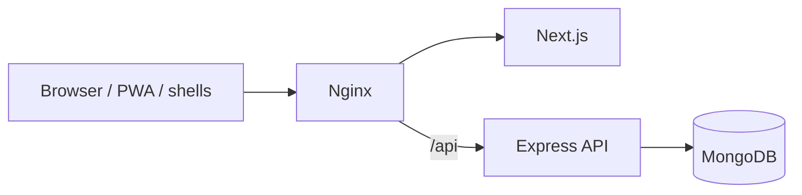

# Mould Tracker — complete guide

## Contents

1. [What Mould Tracker is](#1-what-mould-tracker-is)
2. [Reading paths by role](#2-reading-paths-by-role)
3. [Key concepts](#3-key-concepts)
4. [Getting started](#4-getting-started)
5. [Everyday tasks](#5-everyday-tasks)
6. [The rules the app enforces](#6-the-rules-the-app-enforces)
7. [Roles and permissions](#7-roles-and-permissions)
8. [Workflows](#8-workflows)
9. [Administration](#9-administration)
10. [Technical reference](#10-technical-reference)
11. [Support](#11-support)
12. [Evidence and open questions](#12-evidence-and-open-questions)

---

## 1. What Mould Tracker is

A web app (also a PWA and Windows/Android shells) that tracks every **injection mould** and **extrusion die**: where it is, whether it can be used, what it makes, how many shots it has done, and who did what to it. Details: [introduction](introduction.md), [product overview](product-overview.md).

## 2. Reading paths by role

| Role | Read |
|---|---|
| Production Supervisor | §4, §5.1, §5.4, §5.5, [role page](roles/production-supervisor.md) |
| Mould Technician | §4, §5.1–5.6, §6, [role page](roles/mould-technician.md) |
| Mould Maker | §4, §5.2, §5.3, §5.6, [role page](roles/mould-maker.md) |
| Admin | §5.7, §7, §9, [role page](roles/admin.md) |
| Super Admin | Admin path + racks, audit, Out of Service ([role page](roles/super-admin.md)) |
| IT / System Administrator | §9, §10, [role page](roles/system-administrator.md) |

## 3. Key concepts

- **Locations:** Machine · Production Floor · Workshop · Mould Room (racks, moulds) · Tool Room (dies) · Out of Service.
- **Statuses:** Good · Needs service · Needs repair · In service · In repair.
- **Rack location IDs:** zone + row + number, for example `FLK-A3`.
- **Shots:** counted while mounted; reaching the limit makes the mould service-due.
- **History, Work log, Audit log:** append-only records.

Full list: [glossary](glossary.md).

## 4. Getting started

1. Get an account from an Admin ([prerequisites](getting-started/prerequisites.md)).
2. Sign in with email and password; set EN / සිං ([first login](getting-started/first-login.md)).
3. Change your password in **Account details**; optionally add a passkey (HTTPS only).
4. Learn the sidebar and the mould sheet ([navigation tour](getting-started/navigation-tour.md)).
5. Do the [5-minute quick start](getting-started/quick-start.md).

## 5. Everyday tasks

| # | Task | Who | Guide |
|---|---|---|---|
| 5.1 | Find a mould (Tool ID, Item ID, description, machine, rack) | All | [find-a-mould](user-guide/find-a-mould.md) |
| 5.2 | Move a mould | By permission | [move-a-mould](user-guide/move-a-mould.md) |
| 5.3 | Workshop queue, change status | Workshop roles | [workshop-queue](user-guide/workshop-queue.md) |
| 5.4 | Record shots | Supervisor, Technician, Maker*, Admins | [record-shots](user-guide/record-shots.md) |
| 5.5 | Report a problem | All | [report-a-problem](user-guide/report-a-problem.md) |
| 5.6 | Log work, corrections, photos | Technician, Maker, Admins | [work-log](user-guide/work-log.md) |
| 5.7 | Manage moulds and items | Admins | [manage-moulds](user-guide/manage-moulds.md) |
| 5.8 | Rack view / rack management | All / Super Admin | [rack-view](user-guide/rack-view.md), [rack-management](user-guide/rack-management.md) |
| 5.9 | Machines, users, custom access | Admins / System Administrator | [machines](user-guide/machines.md), [users](user-guide/users.md), [user-access](user-guide/user-access.md) |
| 5.10 | Work log report and export | Admins | [work-log-report](user-guide/work-log-report.md) |
| 5.11 | Audit log | Super Admin | [audit-log](user-guide/audit-log.md) |
| 5.12 | Extrusion dies, install, theme, offline | All | [extrusion-dies](user-guide/extrusion-dies.md), [app-settings-and-install](user-guide/app-settings-and-install.md) |

\*Mould Makers record shots through `workshop.work`, but shots can only be recorded on a machine.

## 6. The rules the app enforces

1. Only **Good** moulds may be mounted, put on the floor or stored; anything else may only go to the Workshop.
2. **In service / In repair** only at the Workshop (or Out of Service).
3. Injection moulds are stored in the Mould Room on a rack; dies are stored in the Tool Room.
4. One mould per machine; the machine must be active.
5. Mount only on listed machines, unless an Admin overrides with a reason.
6. Racks must be active and not full; another zone's rack needs a reason.
7. Remarks are required for Workshop and Out of Service moves and for status changes.
8. Reaching the shot limit flags **Needs service** and blocks mounting; In service → Good resets the count.
9. Status changes only at the Workshop.
10. Every change writes History and the Audit log; work-log entries are never edited.

## 7. Roles and permissions

| Role | Highlights |
|---|---|
| Super Admin | All operations, racks, audit, Out of Service |
| Admin | Moulds, machines, users, reports, overrides; racks read-only |
| Production Supervisor | Machine/floor moves, shots, problem reports |
| Mould Technician | Machine and workshop work, work log |
| Mould Maker | Storage moves, workshop work, work log |
| System Administrator | Everything + User access; protected account |

Full matrix including who may make each move: [permissions-matrix](roles/permissions-matrix.md).

## 8. Workflows

[Overview and state machine](workflows/overview.md) · [Lifecycle](workflows/mould-lifecycle.md) · [Mount/unmount](workflows/mount-and-unmount.md) · [Shots and service](workflows/shot-count-and-service.md) · [Problem to repair](workflows/problem-to-repair.md) · [Workshop cycle](workflows/workshop-repair-cycle.md) · [Out of Service](workflows/out-of-service.md) · [Data import](workflows/data-import.md)

## 9. Administration

[Configuration](administration/configuration.md) · [Security and access](administration/security-and-access.md) · [Operations and recovery](administration/operations-and-recovery.md) · [Deployment](technical/deployment.md)

**Most important operational facts:**

- Production runs on Coolify. Back up MongoDB **and** the uploads folder before any migration.
- The database is shared: never delete existing data.

## 10. Technical reference

[Architecture](technical/architecture.md) · [Repository](technical/repository-structure.md) · [Local development](technical/local-development.md) · [Database](technical/database-reference.md) · [API (55 endpoints)](technical/api-reference.md) · [Integrations](technical/integrations.md)

## 11. Support

[Troubleshooting](support/troubleshooting.md) · [FAQ](support/faq.md) · [Known limitations](support/known-limitations.md) · Demos: [5 min](demonstrations/five-minute-tour.md), [15 min](demonstrations/fifteen-minute-demo.md), [30 min](demonstrations/admin-technical-demo.md), [demo data](demonstrations/demo-data-and-reset.md)

## 12. Evidence and open questions

[EVIDENCE-MATRIX](analysis/EVIDENCE-MATRIX.md) (52 claims) · [GAPS-AND-QUESTIONS](analysis/GAPS-AND-QUESTIONS.md) (9 questions) · [Changelog](DOCUMENTATION-CHANGELOG.md)
