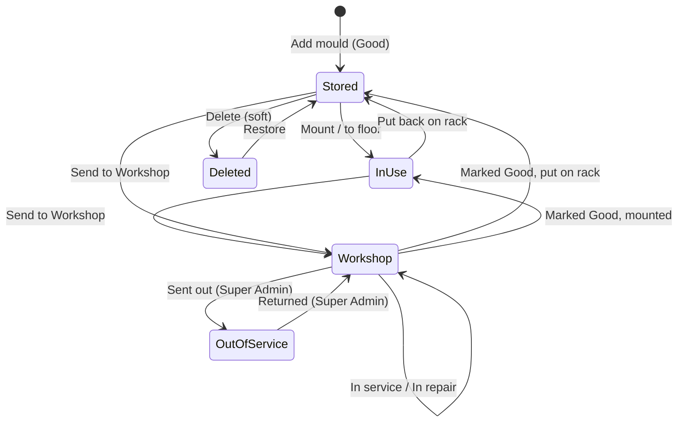

# Introduction

## What is Mould Tracker?

Mould Tracker tracks the injection moulds and extrusion dies ("tools") of a plastics factory. Each tool has a **Tool ID**, a **location**, a **condition (status)**, the **items (products)** it makes, a **shot counter** and a full **history**.

## Problem it solves

Without a system, moulds get lost between machines, racks and the workshop. Nobody knows which mould is due for service, and repair work goes unrecorded. Mould Tracker answers these questions at any moment:

- *Where is mould X?* On a machine, on the production floor, at the workshop, on a numbered rack, in the tool room, or out of service.
- *Can it be used?* It is Good, or it needs service/repair, or it is in service/repair.
- *Who moved it, who worked on it, and when?*

## Objectives (as implemented)

| Objective | How the app does it | Evidence |
|---|---|---|
| One trusted location per tool | Location, machine and rack rules enforced by the database model | `backend/lib/mouldState.js` `mouldStateError` |
| Prevent unsafe use | Only **Good** moulds leave the Workshop; one mould per machine; a reached shot limit blocks mounting | `backend/lib/workflow.js` `planMove` |
| Accountability | Append-only movement history, work log and audit log | `backend/lib/immutable.js`, `models/Movement.js`, `models/AuditLog.js` |
| Role-based control | 6 roles and 19 permissions, enforced on every API call | `backend/lib/permissions.js` |
| Shop-floor usability | Mobile-first PWA, English/Sinhala UI, 10-second auto refresh | `frontend/src/utils/i18n.ts`, `components/MouldSearch.tsx` |

## Scope

**In scope (verified):** tool register and items; locations and moves; Mould Room zones and racks; machines; workshop status; shot counting; work log and problem reports; work-log report with CSV/XLSX export; users, roles and custom access; audit log; passkey sign-in; PWA and native shells.

**Not found in the code:** QR/barcode scanning, notifications (email/SMS/push), scheduled jobs, production planning, spare-parts inventory, approval chains and a general dashboard page. See [known limitations](support/known-limitations.md).

## Lifecycle overview

"Stored" means Mould Room (injection moulds) or Tool Room (extrusion dies). "In use" means on a machine or on the Production Floor.

Next: [Product overview](product-overview.md) · [Glossary](glossary.md)
