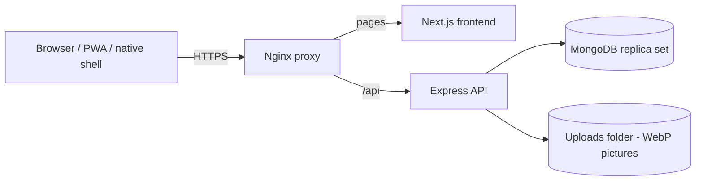
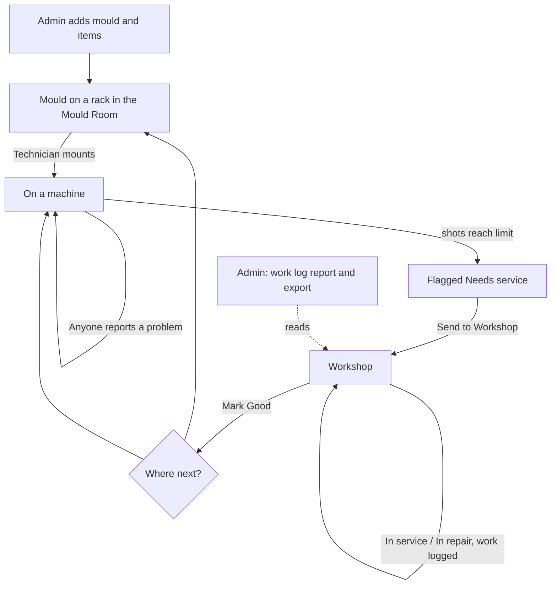

# Product overview

## Who uses it

Six roles (see [Roles](roles/overview.md)): Super Admin, Admin, Production Supervisor, Mould Technician, Mould Maker, and the protected System Administrator.

## Platforms

| Platform | Status | Evidence |
|---|---|---|
| Web browser (desktop and phone), responsive layout | Verified | `frontend/` (Next.js app) |
| Installable PWA with an offline page | Verified | `frontend/src/app/manifest.ts`, `public/sw.js`, `public/offline.html` |
| Windows desktop shell (Electron, unsigned installer) | Verified (source) | `native/desktop/`, `native/README.md` |
| Android shell (WebView APK, Android 8+) | Verified (source) | `native/android/` |
| Apple shell | Source only, no release | `native/apple/`, `native/README.md` |

Native shells only open the server URL; they hold no data. Passkeys are not supported inside the native WebViews (`native/README.md`).

## Architecture

- **Frontend:** Next.js 16, React 19, Tailwind CSS 4, TypeScript.
- **Backend:** Node.js, Express 5, Mongoose 8, Zod validation, JWT session in an HttpOnly cookie, WebAuthn passkeys, Sharp image processing, ExcelJS export.
- **Database:** MongoDB with multi-document transactions, so a replica set is required. Docker Compose stack in `compose.yaml`.

Details: [technical/architecture.md](technical/architecture.md).

## End-to-end process

## System requirements

- **Server:** Docker with Compose, or Node.js plus a MongoDB replica set. See [Deployment](technical/deployment.md).
- **Client:** a current browser. Passkeys need a trusted HTTPS address.

## Known limitations

See [support/known-limitations.md](support/known-limitations.md).
