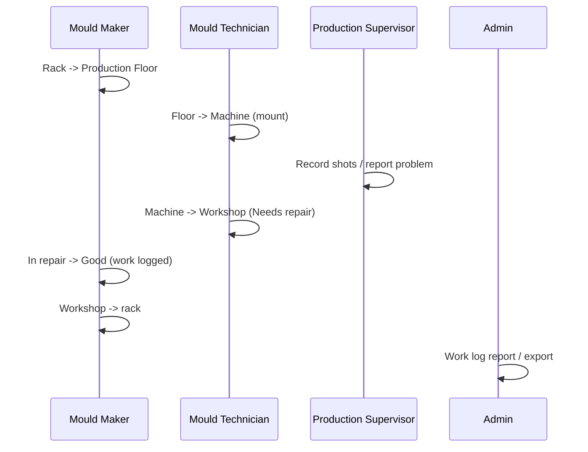

# Roles overview

The code defines exactly six roles (`backend/lib/permissions.js` `ROLES`). Legacy roles `operator` and `viewer` are mapped to Mould Technician and Production Supervisor until the upgrade migration rewrites them.

| Role | Code | In one line | Page |
|---|---|---|---|
| Super Admin | `super_admin` | Everything except custom access; owns racks, audit and Out of Service | [super-admin.md](super-admin.md) |
| Admin | `admin` | Manages moulds, machines, users and reports; racks read-only | [admin.md](admin.md) |
| Production Supervisor | `production_supervisor` | Moves moulds on machines/floor, records shots, reports problems | [production-supervisor.md](production-supervisor.md) |
| Mould Technician | `mould_technician` (default for new users) | Machine and workshop work, logs work | [mould-technician.md](mould-technician.md) |
| Mould Maker | `mould_maker` | Storage moves, workshop work, logs work | [mould-maker.md](mould-maker.md) |
| System Administrator | `system_admin` | All permissions; protected, invisible account | [system-administrator.md](system-administrator.md) |

Full detail: [permissions-matrix.md](permissions-matrix.md).

## Typical handoffs (derived from permissions)

## Separation of duties (as implemented)
- Production Supervisors cannot log work or change workshop status; they report problems.
- Only Super Admins change the rack layout, send moulds Out of Service and read the audit log.
- Only System Administrators manage custom access, and their accounts are hidden from everyone else.
- Admins cannot touch Super Admin accounts.

*Requires product-owner confirmation:* the shift-level escalation path (who to call when a move is refused).
