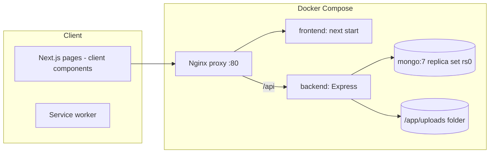
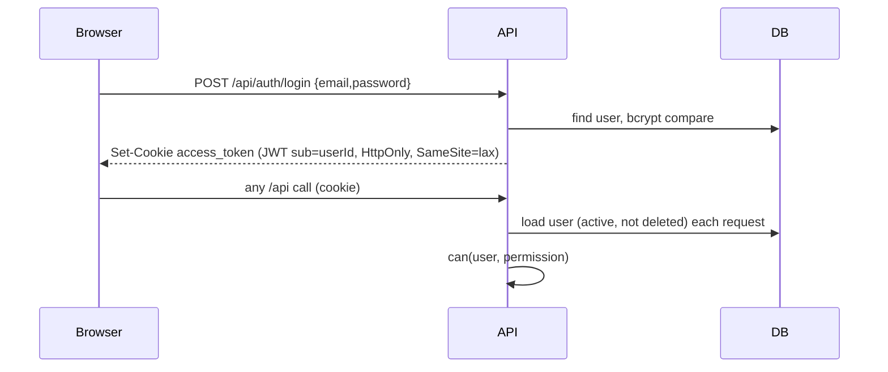

# Architecture

## Backend layering
| Layer | Folder | Responsibility |
|---|---|---|
| Routes | `routes/` | Route tables `[method, path, permissions, handler, bodySchema, querySchema]`, built by `routerFrom` (auth → permission → validation → privacy → handler) |
| Validation | `validators/schemas.js` | Zod schemas |
| Controllers | `controllers/` | Load documents, call pure rules, save in a transaction with Movement + AuditLog |
| Rules (pure) | `lib/workflow.js`, `lib/workLog.js`, `lib/mouldState.js`, `lib/permissions.js` | All business decisions; unit-tested without a DB |
| Models | `models/` | Mongoose schemas, invariants, indexes, immutability plugin |
| Privacy | `middleware/accountPrivacy.js`, `lib/accountPrivacy.js` | Replaces protected users with "Private user" in every JSON response |

## Frontend
Next.js App Router. Route group `(tracker)` shares `AppLayout` (session check, sidebar, 60 s permission refresh). Data via `utils/api.ts` (fetch with credentials). Permissions mirrored in `utils/permissions.ts` for display only. i18n in `utils/i18n.ts` (en, si). The PWA service worker is `public/sw.js`.

## Authentication flow

## Key design decisions (from code comments)
- Rules are pure functions so they can be tested exhaustively (`backend/test/workflow.test.js`).
- History stores text snapshots (machine code, rack ID, person name) so renames never rewrite the past.
- Pictures are content-hashed WebP files, cached immutably.
