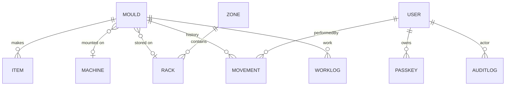

# Database reference

MongoDB via Mongoose 8. Transactions are required (replica set). Schema files: `backend/models/`.

## Mould
| Field | Type | Notes |
|---|---|---|
| toolId | String | required, unique, uppercase, ≤100 |
| toolType | enum | `INJECTION_MOULD` (default), `EXTRUSION_DIE` |
| toolSetCount, size | String | ≤50 |
| owner | String | zone code, uppercase, ≤10 |
| capableMachines | [String] | machine codes |
| status | enum | `GOOD, NEEDS_SERVICE, NEEDS_REPAIR, IN_SERVICE, IN_REPAIR` |
| location | enum | `MACHINE, PRODUCTION_FLOOR, WORKSHOP, MOULD_ROOM, TOOL_ROOM, OUT_OF_SERVICE`; validated by `mouldStateError` |
| machineId / rackId | ObjectId | only with MACHINE / MOULD_ROOM |
| awaitingRack | Boolean | imported, no rack yet |
| shotsToService, totalShots, lastServicedAt | Number/Date | rule 8 |
| notes, remarks | String ≤2000 | remarks = latest service/repair note |
| outOfServiceDetails | DispatchDetails | recipientName, address, repairDetails, sentAt, returnedAt |
| lastMovedAt/By, lastWork, openProblem | | denormalised for cards |
| deletedAt/By | | soft delete |
| version | Number | optimistic lock |

Indexes: unique `machineId` where `location = MACHINE` (one mould per machine); `capableMachines`; `openProblem.at`; status, location, rackId, deletedAt.

## Item
`mouldId, itemId` (unique per mould), description, cavities, qas, materialId/Description, masterbatchId/Description, `images[{path, thumbPath, width, height, source}]`, notes, sortOrder, deletedAt.

## Machine
`code` (unique, uppercase), `name`, `active`.

## Zone / Rack
- Zone: `code` (unique, `[A-Z0-9]{1,10}`), name, active, sortOrder, deletedAt.
- Rack: zone, row (`[A-Z]{1,3}`), number (1–999), code, `locationId` (unique, `ZONE-CODE`), capacity (null = unlimited), active, note, deletedAt.

## Movement (append-only)
mouldId, toolId, type (`CREATED, EDITED, MOVED, STATUS_CHANGED, DELETED, RESTORED, IMPORTED`), from/to location, status, machineId+code snapshot, rackId+locationId snapshot, outOfServiceDetails, remarks, overrideReason, performedBy, createdAt.

## WorkLog (append-only)
mouldId, toolId, type (`REPAIR, SERVICE, MINOR_FIX, INSPECTION, CLEANING, OTHER`), description, partsUsed, timeSpentMinutes, doneBy[1–5]{userId,name,role}, recordedBy, doneAt, place snapshot, statusBefore/After, shots, outcome (`OK, NEEDS_REPAIR, NEEDS_SERVICE`), sentToWorkshop, photos[≤3], correctsId, problemReported, resolvesProblemId. Indexes on doneAt plus mould, person, type, machine and problem.

## AuditLog (append-only)
actorId (null = system), actorName, action, entityType, entityId, entityLabel, before, after, reason, ip, createdAt.

## User
name, email (unique, lowercase), passwordHash (bcrypt, cost 12), role, permissionOverrides (null = role defaults), language (`en`/`si`), active, deletedAt.

## Passkey / AuthChallenge
Passkey: userId, credentialId (unique), publicKey, counter, transports, name, deviceType, backedUp, lastUsedAt. AuthChallenge: short-lived WebAuthn challenges.

## Legacy / support
`Tool`, `ToolMovement` (pre-upgrade model, kept for migration), `MigrationRun` (one-time migration record).

## Retention
Nothing is hard-deleted by the app: moulds, items, racks, zones and users are soft-deleted; history, work log and audit are append-only (`backend/lib/immutable.js`). No retention or purge job exists.
