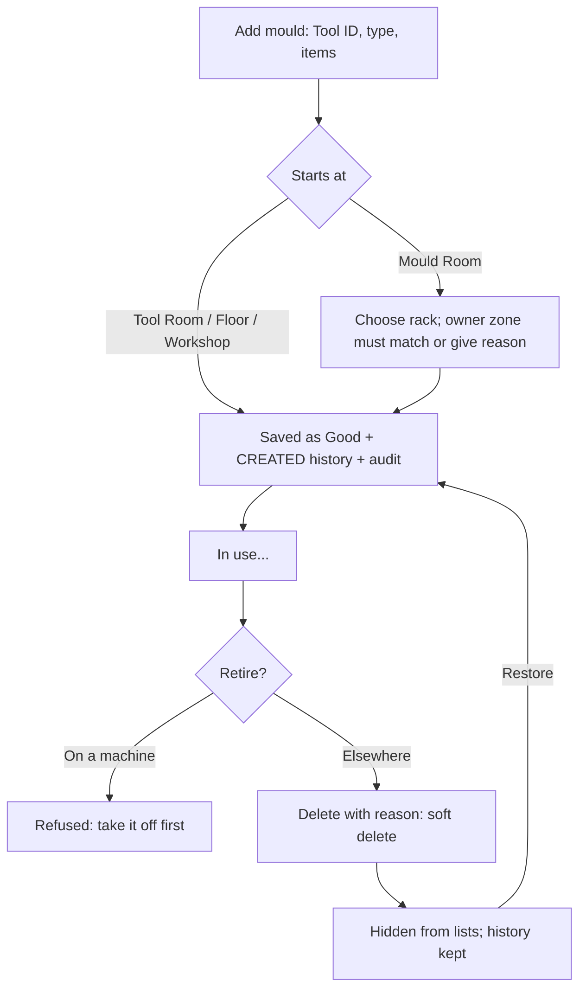

# Mould registration and retirement

**Trigger:** a new mould arrives, or one is retired. **Actor:** Admin / Super Admin (`moulds.manage`).

**Outputs:** History `CREATED` / `DELETED` / `RESTORED`; audit `mould.created` / `mould.deleted` / `mould.restored`.
**Failure paths:** `DUPLICATE_TOOL_ID`, `RACK_REQUIRED`, `RACK_FULL`, `OWNER_MISMATCH`, `UNMOUNT_FIRST`.

Details: [Manage moulds](../user-guide/manage-moulds.md).
