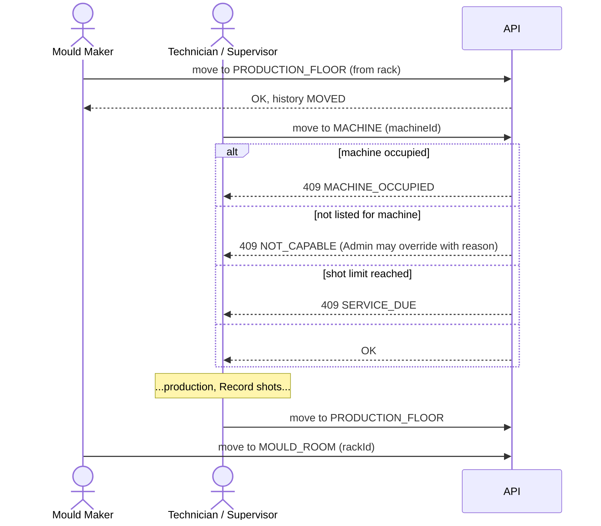

# Mount and unmount

**Trigger:** production needs a mould on a machine.

## Who does which step

Only Admins and Super Admins hold both `moves.mouldRoom` and `moves.machine`, so only they can go rack → machine directly. On the shop floor the move is a **two-person handoff**:

## Decision points
- Status must be **Good** (`NOT_GOOD`).
- The machine must be active and free; the mould must be listed for it or overridden.
- When going back to a rack: the rack must be active and not full; if the owner zone differs, a reason is required.

## Audit implications
Every move: `Movement` (from/to location, machine code, rack location ID, override reason) + `AuditLog` `mould.moved`.

Steps per screen: [Move a mould](../user-guide/move-a-mould.md).
