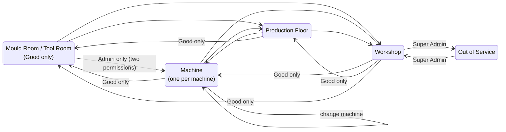

# Workflows overview

| Workflow | Trigger | Actors | Page |
|---|---|---|---|
| Mould registration and retirement | New mould / mould no longer used | Admin | [mould-lifecycle.md](mould-lifecycle.md) |
| Mount and unmount | Production needs a mould | Maker, Technician, Supervisor, Admin | [mount-and-unmount.md](mount-and-unmount.md) |
| Shot count and service | Shift production | Supervisor, Technician | [shot-count-and-service.md](shot-count-and-service.md) |
| Problem → repair | Someone sees a defect | Anyone → Technician/Maker | [problem-to-repair.md](problem-to-repair.md) |
| Workshop repair cycle | Mould needs service/repair | Technician, Maker | [workshop-repair-cycle.md](workshop-repair-cycle.md) |
| Out of Service (external repair) | Repair outside the factory | Super Admin | [out-of-service.md](out-of-service.md) |
| Data import and migration | Initial load / workbook update | IT (CLI) | [data-import.md](data-import.md) |

Not found in the code: approvals, scheduled maintenance plans, notifications, archival beyond soft delete.

## The two state rules (always enforced)

1. A mould that is **not Good** may only be at the Workshop, on a machine, on the Production Floor or Out of Service. It is **never in storage**.
2. **In service / In repair** may only be at the Workshop or Out of Service.

These rules are checked by the database model on every save (`mouldStateError`), not just by the UI.

## Concurrency and failure handling
- **Optimistic locking:** writes carry the mould's `version`. If it changed, the result is `409 STALE` ("…was changed by someone else. Refresh and try again.").
- **Transactions:** each change and its History + Audit lines are saved together or not at all (`withTransaction`, `backend/config/db.js`).
- **Database guards:** a unique index allows one mould per machine; Tool IDs are unique.
- **Double submits:** the UI disables buttons while saving (`rack-admin`, `users` pages).
- **Offline:** no offline queue; actions need the server.
