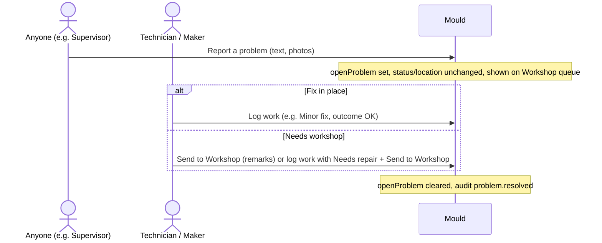

# Problem to repair

**Failure paths:** a Supervisor cannot move to the Workshop; they hand over to a Technician/Maker. When a Needs… outcome is logged while the mould is in storage, the entry is saved with warning `WORKSHOP_MOVE_REQUIRED`.

Related: [Report a problem](../user-guide/report-a-problem.md) · [Work log](../user-guide/work-log.md)
