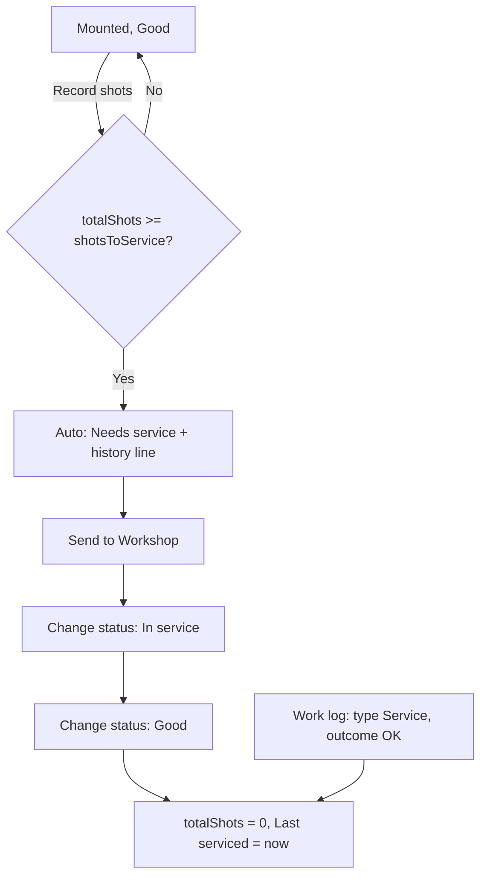

# Shot count and service

## Rules
- Only applies when **Shots to service** is set (> 0).
- Auto-flag happens only for **Good** moulds **outside storage**. In storage the status stays Good, but mounting is refused with `SERVICE_DUE`.
- Setting **Good** directly from Needs/In repair while still over the limit is refused; it must go through **In service**.
- A work-log entry of type **Service** with outcome **OK** also resets the count, wherever the mould is.
- The stats endpoint counts `serviceDueNotFlagged` (over the limit but still Good, for example in storage).

Evidence: `planShots`, `serviceDueChange`, `planStatus` in `backend/lib/workflow.js`; `planWorkLog` in `backend/lib/workLog.js`; `mouldStats` in `backend/controllers/mouldController.js`.
