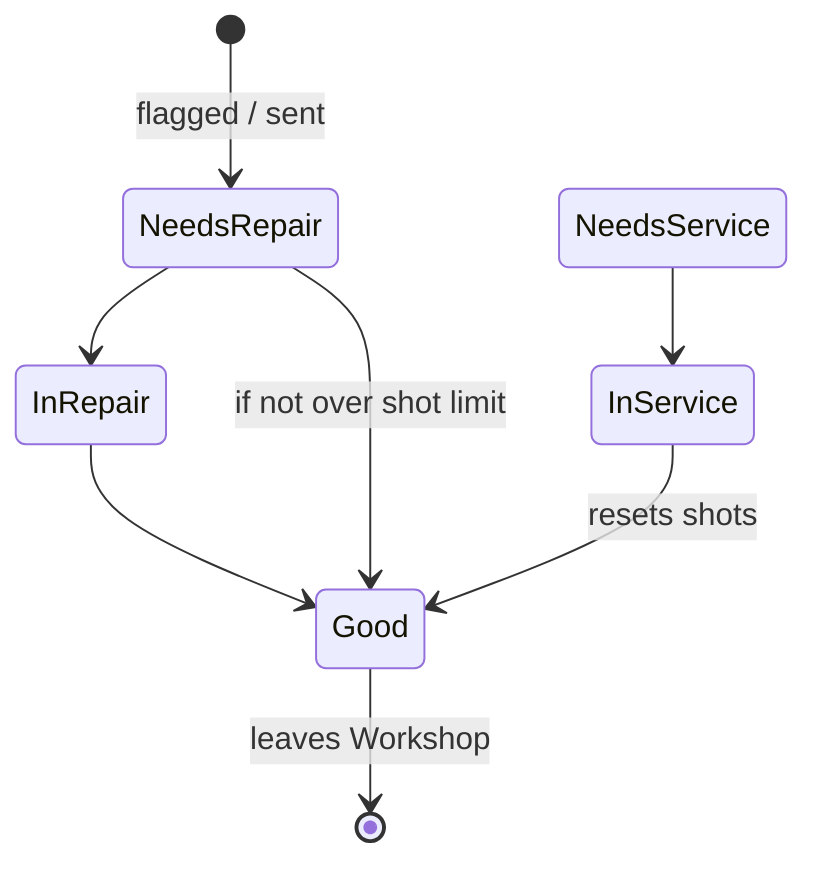

# Workshop repair cycle

| Step | Actor | Action | Result |
|---|---|---|---|
| 1 | Technician / Maker | **Send to Workshop**, optional New status, **Remarks** required | Location Workshop; latest remarks shown; open problem resolved |
| 2 | Technician / Maker | **Change status** → In repair / In service (remarks) | `STATUS_CHANGED` |
| 3 | Technician / Maker | Log work (type, parts, time, people, photos) | Work log entry; "Last work" on the card |
| 4 | Technician / Maker | **Change status** → Good (remarks) | From In service: shots reset |
| 5 | Maker (to rack) or Technician/Supervisor (to machine) | Move out | Only Good moulds leave |

Related: [Workshop queue](../user-guide/workshop-queue.md)
